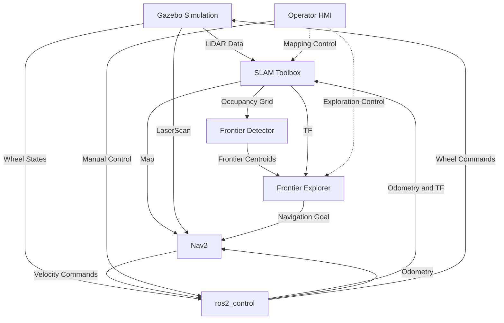
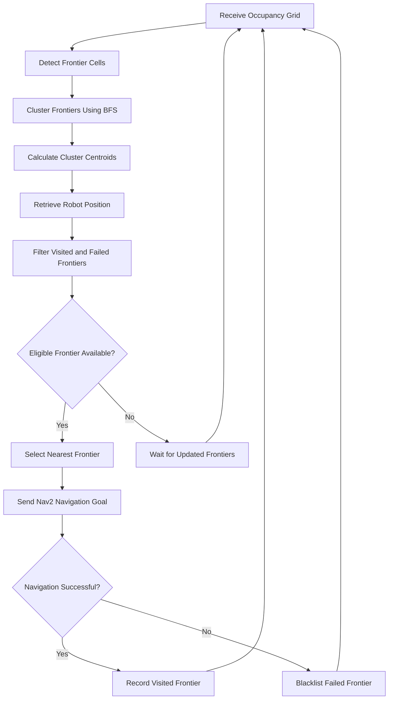

# 🗺️ Autonomous Mobile Robot – SLAM & Frontier-Based Exploration


---

## 📖 Project Overview

Development of a ROS 2-based autonomous mobile robot (AMR) capable of mapping and autonomously exploring unknown indoor environments within a simulated environment.

The system integrates LiDAR-based simultaneous localisation and mapping (SLAM), autonomous navigation, differential-drive motion control and custom frontier-based exploration algorithms.

The primary objective is to enable the robot to independently identify unexplored regions, generate navigation goals and progressively construct an occupancy grid map without requiring manual intervention in goal selection.

---

## 🎬 Autonomous Exploration Demonstration

<p align="center">
  
  &nbsp;&nbsp;&nbsp;
  
</p>

---

## ✨ Key Features

- Autonomous exploration of unknown environments.
- Real-time LiDAR-based mapping and localisation.
- Custom frontier detection and clustering algorithms.
- Autonomous navigation goal generation.
- A* global path planning.
- Regulated Pure Pursuit path following.
- Obstacle avoidance using dynamic costmaps.
- Differential-drive robot modelling and control.
- Custom graphical human-machine interface (HMI).
- Occupancy grid map generation and export.

---

## ⚙️ System Architecture



---

## 🤖 Robot Modelling & Motion Control

The autonomous mobile robot was modelled using URDF and Xacro and integrated into a custom Gazebo simulation environment.

The robot incorporates a differential-drive configuration, simulated 2D LiDAR and wheel odometry.

### Robot Configuration

| Parameter | Value |
|---|---|
| Drive configuration | Differential drive |
| Wheel radius | 0.10 m |
| Wheel separation | 0.30 m |
| Controller update rate | 100 Hz |
| Odometry publication rate | 50 Hz |
| Maximum linear velocity | 0.50 m/s |
| Maximum angular velocity | 1.50 rad/s |
| Sensor | Simulated 2D LiDAR |

Motion control is implemented using ros2_control and the differential-drive controller, with configurable velocity and acceleration limits.

---

## 📍 Simultaneous Localisation and Mapping (SLAM)

SLAM Toolbox is used to construct a two-dimensional occupancy grid while simultaneously estimating the robot's position within the environment.

The mapping system incorporates:

- LiDAR scan matching.
- Wheel odometry.
- Coordinate transformations using TF2.
- Loop closure.
- Continuous occupancy grid updates.

### SLAM Configuration

| Parameter | Configuration |
|---|---|
| SLAM implementation | SLAM Toolbox |
| Operating mode | Asynchronous mapping |
| Map resolution | 0.05 m/cell |
| Configured maximum laser range | 8.0 m |
| LiDAR topic | `/scan` |
| Occupancy grid topic | `/map` |
| Reference frames | `map`, `odom`, `base_link` |
| Loop closure | Enabled |

---

## 🧠 Frontier-Based Autonomous Exploration

The autonomous exploration functionality is implemented through two custom Python ROS 2 nodes:

- Frontier Detector
- Frontier Explorer

A frontier represents the boundary between known free space and unexplored regions within the occupancy grid.

By identifying and navigating towards these boundaries, the robot can progressively expand its knowledge of the environment.

### 1. Frontier Detection

[View source code](src/amr_exploration/amr_exploration/frontier_detector.py)

The frontier detection node processes the occupancy grid generated by SLAM Toolbox.

The algorithm performs the following operations:

1. Subscribe to the occupancy grid.
2. Identify free cells adjacent to unknown cells using an eight-connected neighbourhood.
3. Group neighbouring frontier cells using Breadth-First Search (BFS).
4. Filter clusters containing fewer than 10 cells.
5. Calculate the centroid of each remaining frontier cluster.
6. Convert occupancy grid coordinates into map coordinates.
7. Publish frontier cells and centroids as visualisation markers.

### 2. Frontier Selection & Navigation

[View source code](src/amr_exploration/amr_exploration/frontier_explorer.py)

The frontier exploration node is responsible for autonomous navigation goal selection.

The algorithm:

1. Retrieves the current robot position using TF2.
2. Evaluates available frontier centroids.
3. Excludes previously visited, nearby and blacklisted frontiers.
4. Calculates the Euclidean distance to each eligible frontier.
5. Selects the nearest eligible frontier.
6. Sends a navigation goal through the Nav2 NavigateToPose action interface.
7. Evaluates the navigation result.
8. Records successful goals or blacklists failed navigation targets.
9. Repeats the exploration process.

### Exploration Workflow



---

## 🧭 Autonomous Navigation & Path Planning

The ROS 2 Navigation Stack (Nav2) is responsible for global path planning, local motion control and obstacle handling.

### Navigation Configuration

| Component | Implementation |
|---|---|
| Global planner | NavFn |
| Path planning algorithm | A* |
| Path following controller | Regulated Pure Pursuit |
| Navigation interface | NavigateToPose Action |
| Global costmap | Static, obstacle and inflation layers |
| Local costmap | Obstacle and inflation layers |
| Costmap resolution | 0.05 m |
| Configured robot radius | 0.23 m |
| Inflation radius | 0.35 m |
| Controller frequency | 10 Hz |
| Desired navigation velocity | 0.12 m/s |

The global planner generates navigation paths through the occupancy grid, while the path-following controller generates velocity commands for the differential-drive robot.

LiDAR observations are incorporated into the global and local costmaps to support obstacle detection and avoidance.

---

## 🖥️ Human-Machine Interface (HMI)

A custom Python-based graphical user interface was developed using Tkinter to provide centralised operation and monitoring of the autonomous mobile robot.

### HMI Functionality

- Launch and terminate mapping mode.
- Start and stop autonomous exploration.
- Manual directional robot control.
- Adjustable linear and angular velocities.
- Hold-to-move directional controls.
- Map naming and export.
- Process monitoring and logging.
- System shutdown and process management.

<p align="center">
  
</p>

---

## 🗺️ Mapping & Visualisation

The system progressively generates an occupancy grid as the robot explores the simulated environment.

Generated maps can be exported using the Nav2 map server and stored in PGM format with associated YAML metadata.

<p align="center">
  
  &nbsp;&nbsp;&nbsp;
  
</p>

---

## 📁 Repository Structure

```text
AMR-SLAM-Auto-Exploration/
│
├── maps/
│   ├── my_map.pgm
│   └── my_map.yaml
│
└── src/
    ├── amr_bringup/
    │   ├── config/
    │   ├── launch/
    │   └── my_world/
    │
    ├── amr_control/
    │   └── config/
    │
    ├── amr_description/
    │   ├── launch/
    │   └── urdf/
    │
    ├── amr_exploration/
    │   └── amr_exploration/
    │       ├── frontier_detector.py
    │       └── frontier_explorer.py
    │
    └── amr_hmi/
        └── amr_hmi/
            └── hmi.py
```

### ROS 2 Packages

| Package | Description |
|---|---|
| amr_bringup | System launch files, simulation environment and navigation configuration |
| amr_control | Differential-drive controller configuration |
| amr_description | Robot modelling, URDF and Xacro |
| amr_exploration | Custom frontier detection and autonomous goal selection |
| amr_hmi | Graphical operator interface |

---

## 🚀 Getting Started

### Dependencies

- ROS 2 Humble
- Gazebo Classic
- SLAM Toolbox
- Navigation2
- ros2_control
- ros2_controllers
- gazebo_ros2_control
- Xacro
- Python Tkinter
- Colcon

### Build Workspace

```bash
git clone https://github.com/davidrcm1/AMR---SLAMs---Auto-exploration.git ~/amr_ws

cd ~/amr_ws

source /opt/ros/humble/setup.bash

rosdep install --from-paths src --ignore-src -r -y

colcon build --symlink-install

source install/setup.bash
```

### Launch HMI

```bash
ros2 run amr_hmi hmi
```

Start mapping mode before enabling autonomous exploration.

### Alternatively, Launch Manually

Terminal 1 – Mapping:

```bash
ros2 launch amr_bringup mapping.launch.py
```

Terminal 2 – Autonomous Exploration:

```bash
ros2 launch amr_bringup exploration.launch.py
```

Ensure the ROS 2 and workspace environments are sourced in each terminal.

---

## 🔬 Future Development

- Information-gain-based frontier selection.
- Path-cost-based exploration prioritisation.
- Improved navigation timeout and recovery handling.
- Exploration completion detection.
- Quantitative mapping and navigation performance evaluation.
- Physical AMR hardware integration and validation.

---

## 🛠️ Technologies & Engineering Skills


---

## 👨‍💻 Author

**David Ceballos**

Mechatronics Engineer | Robotics & Autonomous Systems

[](https://github.com/davidrcm1)
